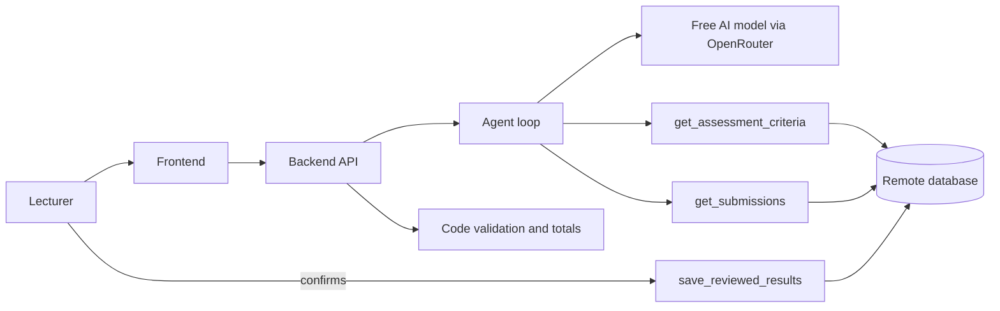

# Qeleme: AI Teaching Assessment Agent — Design Note

## Workflow

Request, then clarification if essential information is missing (no assessment or batch named), then the agent retrieves the rubric and answers using two retrieval tools, the model proposes scores and evidence for each criterion, code validates (never clamps), the lecturer reviews and corrects, then confirms and the result is saved and can be reopened.

## Agent (Section D21 — Person 3)

The agent (`backend/app/agent.py`) runs a bounded loop: at most `MAX_MODEL_TURNS=5` model turns, `MAX_TOOL_CALLS=4` tool calls, and `RUN_TIMEOUT_SECONDS=60` wall-clock. It never auto-retries on timeouts or 429s — the OpenAI SDK is configured with `max_retries=0` to avoid burning the 50-request daily free quota.

**Retrieval.** The model calls `get_assessment_criteria` and `get_submissions` by itself. Before the model sees the answers, the agent sanitises them: `detect_answer_status` flags blank or unassessable answers, removes them from the model input, and remembers them for code-side zero-scoring. Each remaining answer is wrapped in a delimited block with a per-run random nonce (`===ANSWER nonce=<nonce> student=<id>===`), so student text never touches the system prompt and cannot act as an instruction.

**Output.** The model returns JSON (parsed by `parse_model_output`, which strips think blocks, markdown fences, and extracts the first balanced JSON object). Code validates via `scoring.validate_model_output`: scores must be integers in range, quotes must exist in the answer, and `blank`/`needs_manual_grading` can only be set by the backend. A `needs_clarification` response is returned immediately with a question, no tools called.

**Retry.** One retry per run, shared across unparseable output and invalid students. The corrective message lists the failed student ids and reasons, asks for complete JSON again, and omits tools (data is already in context). Anyone still invalid after the retry becomes `needs_manual_grading` — no scores, flagged for the lecturer.

**Failure switch.** `FORCE_AI_FAILURE=1` creates the run, marks it failed, and returns a quota error with zero provider calls and zero tool calls. Cap exhaustion and timeout produce clear error dicts with `run_id` so the UI can offer a manual retry.

**Provider interface.** `ai_provider.py` exposes `generate(messages, tools, response_format) -> ProviderResponse` and `get_provider()`. OpenRouter uses the `openai` SDK pointed at `https://openrouter.ai/api/v1`; the stub uses a scripted fake for development. Errors map to `AIError("timeout")`, `quota`, or `invalid_output`.

**What the model never does.** It never calls `save_reviewed_results` (not in its tool list), never computes totals (computed in code), and its scores are never clamped (invalid scores are rejected, not silently corrected).

## Validation and scoring

See `docs/design-note-validation.md` (Person 4). Key handoff: `run_grading` returns a list of proposal dicts that `save_proposals` stores — one per submission, with `student_id`, `answer_status`, `scores {cid: int}`, `evidence`, `explanations`, `flags`, `feedback`. Blank/unassessable students get zeros and a flag. Invalid-after-retry students get `needs_manual_grading` with `None` scores and `FLAG_MANUAL`.

## Three tools

`get_assessment_criteria` and `get_submissions` (retrieval, given to the model). `save_reviewed_results` (save, after the lecturer confirms — NOT given to the model). The agent also uses `catalog()` as injected context (not a fourth tool) to resolve free-text requests.

## Storage

UUID run ids; proposals stored in `ai_proposals` with `answer_status` restricted to the allowed set by the schema. Tool calls logged in `tool_logs`. `model_requests` counter on `grading_runs` (gap request to P2).

## Free services

OpenRouter free models only (IDs ending `:free`). 20 req/min, 50 req/day on non-billing accounts. `DAILY_MODEL_REQUEST_CAP=40` enforced in `limits.py`. Development uses the stub provider; live calls reserved for Gate 0, Gate 2, test cases, and demo.

## Member responsibilities

See `docs/contribution-note.md`.
