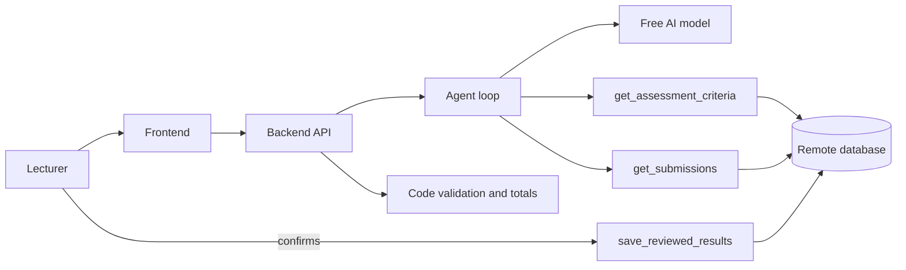

# Design note (1 to 2 pages)

## Workflow
Request, then clarification if essential information is missing, then the agent retrieves the assessment and the answers, the model proposes scores, code enforces limits and totals, the lecturer reviews and confirms, the result is saved and can be reopened.

## Three tools
`get_assessment_criteria`, `get_submissions` (retrieve), `save_reviewed_results` (save, after the lecturer confirms).

## Storage
TODO (P2)

## Free services
TODO (see service-register.md)

## Member responsibilities
See contribution-note.md. TODO: one line per person.
