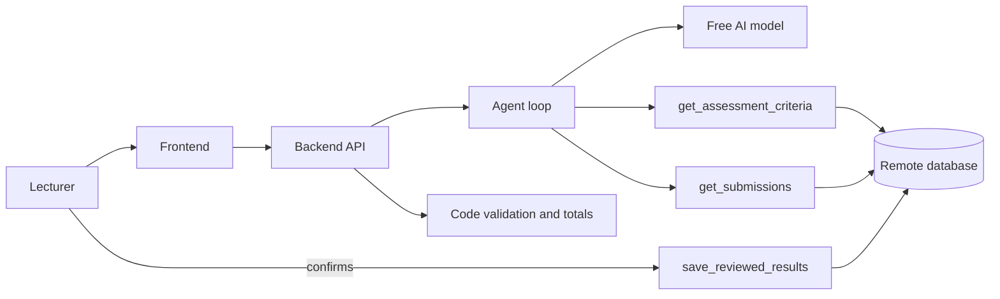

# Design note (1 to 2 pages)

## Workflow
Request, then clarification if essential information is missing, then the agent retrieves the assessment and the answers, the model proposes scores, code enforces limits and totals, the lecturer reviews and confirms, the result is saved and can be reopened.

## Validation and scoring (Person 4)
**Principle.** The AI proposes, the code validates, the lecturer decides. Model output is untrusted. Every number that reaches the lecturer or the database is checked or calculated in `backend/app/scoring.py`, which has no network or database dependency and is covered by automated tests.

**Before the model.** `detect_answer_status` marks an answer `blank` (empty, whitespace or punctuation only) or `unassessable` (fewer than 3 letters). Those answers never reach the model. Zeros are proposed and a flag is added. Blank answers cost no quota and cannot be credited by mistake.

**After the model.** `validate_model_output` checks every student the model was asked about:

- Each rubric criterion appears exactly once, with no unknown ids.
- Each score is a whole number from 0 to that criterion's maximum. Scores are never clamped, because silently turning 3 into 2 would hide a model error and put a number in front of the lecturer that nobody chose. A bad score makes that student invalid instead.
- The model may only set `complete`, `incomplete` or `unassessable`. `blank` and `needs_manual_grading` belong to the backend.
- Missing students are marked invalid. Unknown students and results for answers handled in code are dropped and noted in the run log. A duplicated student has every row rejected.
- Invalid students are retried once, as a batch, for the whole run. Anyone still invalid becomes `needs_manual_grading`: no scores are proposed and the lecturer must enter every criterion before Confirm is enabled. Other students are unaffected.

**Evidence.** `evidence_found` normalises whitespace, case and quote marks, then checks that the quote appears inside the student's answer. An empty quote means "no supporting evidence found", which is not a failure. A quote that is not in the answer is shown as "Quote not found in answer" with a flag. The score is kept, because the quote may be a paraphrase while the mark is right, and the decision belongs to the lecturer.

**Injection.** The prompt tells the model that answers are data. If the model obeys anyway, code is the second layer. An answer containing instruction-like text is flagged, and a result that gives full marks to such an answer is rejected, then retried, then sent to manual grading. This is a heuristic backstop for obvious attacks, not a guarantee (see limitations).

**Lecturer review.** `validate_review` requires every student in the batch exactly once, every criterion exactly once, integer scores in range, and scores for every `needs_manual_grading` student. It returns field-level errors for the 422 response. Totals and percentages (rounded half-up to one decimal) are always calculated by the backend from the rubric maximums. Any total the browser sends is ignored.

**Atomic saves.** With P2, confirming writes every `reviewed_results` row in one transaction. A failure leaves no partial rows, the unique constraint on submission id refuses a second confirm, and the AI proposal is stored in its own table and never edited.

## Agent, three tools and prompts (Person 3)
**Plan used: the base design.** The model chooses the two retrieval tools, `get_assessment_criteria` and `get_submissions`. `save_reviewed_results` is not offered to the model: it runs when the lecturer presses Confirm, after validation. (Organizer answer on whether the model must select the save tool: TODO P5. Plan B is described in the build plan, section 4.)

**The loop** (`agent.py`). The backend first works out which assessment and batch is meant, from the ids in the request or by matching its text to assessment titles and batch labels. If that is unclear, or the assessment has no rubric or reference answer, the lecturer gets a clarification question and nothing is guessed. Then it creates a run (committed at once, so a failed run still leaves a record) and the model calls the two tools. Every call is logged with the run id. Code checks the ids in each call, so a model that invents an id gets an error back and nothing runs.

**Caps per run.** 4 tool-phase model turns plus one grading call, 4 tool calls, 60 seconds in total. The only extra call is the single retry. Hitting a cap closes the run as failed with a clear message and a retry button. Nothing loops by itself.

**Grading call.** Blank and too-short answers are removed in code before the model sees anything. The remaining answers go into one call, inside delimited blocks that the prompt calls data, never instructions. The reply is parsed as JSON and handed to `scoring.validate_model_output`, so one bad score rejects only that student. Invalid students get one retry, with the reasons, for those students only. Anyone still invalid becomes `needs_manual_grading`. Proposals are saved in one transaction with `runs.save_proposals`.

**Provider** (`ai_provider.py`). One `generate` function over an OpenAI-compatible chat API. Function calling and JSON output are never mixed in one request. Provider errors become four plain kinds (timeout, quota, invalid output, unavailable) plus `tool_limit` from the agent. No key, URL or stack trace reaches a message. `FORCE_AI_FAILURE=1` makes every call fail with the quota error before any network call.

**Injection.** Layer 1 is the prompt: answers are data and instructions inside them are ignored. Layer 2 is code (`scoring.detect_injection`): instruction-like answers are flagged, and full marks given to one are rejected. The model, its limits and the free-plan facts are in `service-register.md`.

Tools: `get_assessment_criteria`, `get_submissions` (retrieve), `save_reviewed_results` (save, after the lecturer confirms).

## Storage
TODO (P2)

## Free services
TODO (see service-register.md)

## Member responsibilities
See contribution-note.md. TODO: one line per person.
